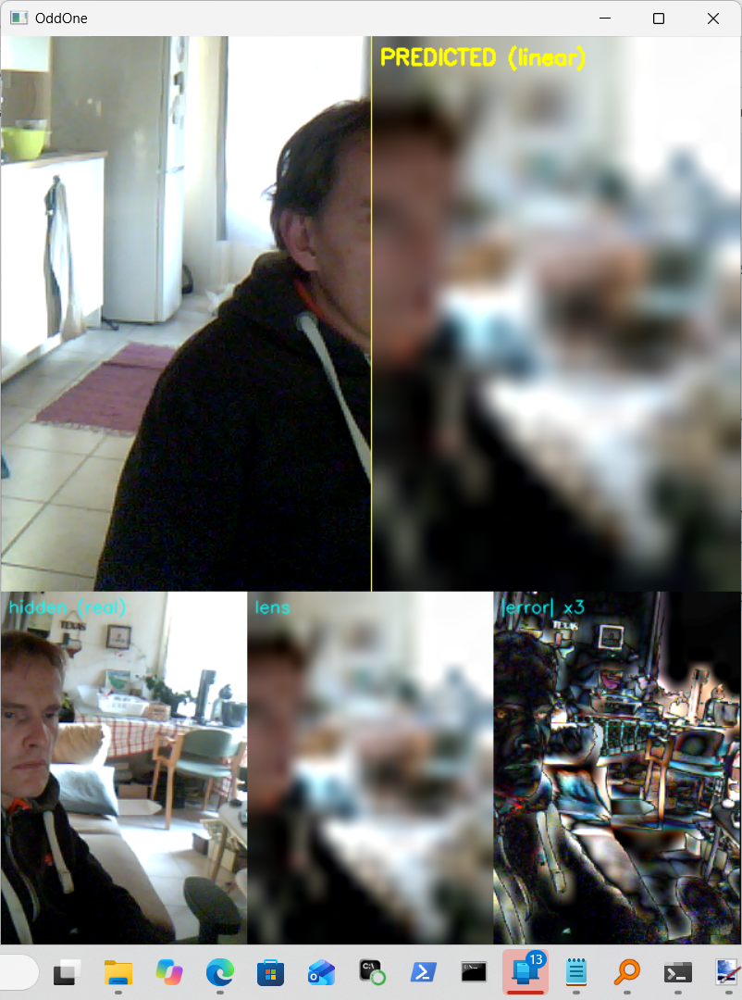
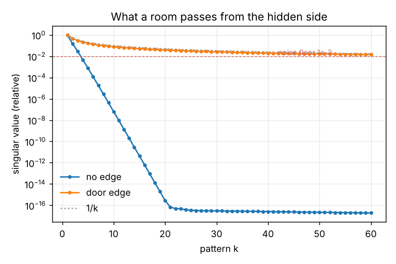

# OddOne



**Can one half of a webcam image learn to see the other half?**

Split the webcam picture down the middle. The **visible** half is the only
input. The **hidden** half is the teacher, shown to the learner only while it
trains: ground truth, live. After training, press **H**: the hidden half is
switched off and replaced by what the lens *thinks* is there.

It's the A–B–C idea, and a cousin of Varjoluotain and KulmanTakaa: the hidden
half's light bounces, shadows and colour casts reach the visible half, and the
lens has to learn to read them back. Unlike Varjoluotain, there is **no
occluder model**. The lens learns whatever this particular room passes.

## Run it

```bash
pip install -r requirements.txt     # numpy, opencv-python; torch optional (CNN lens)
python oddone.py                    # Windows: if the camera is slow to open, add --dshow
python oddone.py --hidden left      # hide the left half instead
python oddone.py --no-cnn           # linear lens only
```

| key | does |
|---|---|
| `space` | learning on / off (freeze the lens to test it) |
| `h` | hide the hidden half; show the prediction in its place |
| `m` | switch shown lens: linear ↔ CNN |
| `c` | count channels: how many independent things the visible half tells about the hidden one (needs ~300 learned frames) |
| `e` | try to lock auto-exposure (see "the exposure trap" below) |
| `r` | reset everything |
| `s` / `l` | save / load the linear lens |
| `q`, `Esc` | quit |

The bottom strip shows the real hidden half, the lens's version, the error
×3, the two scores and the channel bars.

## The two lenses

- **Linear lens.** The best linear map from visible to hidden (the Wiener /
  linear MMSE estimator), learned from running covariances with slow
  forgetting. Light transport is linear, so this is the physics-shaped lens:
  `visible change = A · hidden change`, and it learns the inverse directly from
  data. Runs on CPU, about 4 ms per frame.
- **CNN lens** (if PyTorch is installed). A small encoder-decoder trained
  online on the GPU, your living mirror again, with the hidden half as
  teacher. Stronger, but also much better at **guessing from habit**.

## The score is honest

Every frame is predicted **before** the lens learns from it, so the score is
always on a frame the lens has never seen. It's the R² of the **change** in
the hidden half:

- **0** means no better than "it looks like it usually does";
- **1** means the change is predicted perfectly.

A lens that has merely memorised your room's usual look scores 0. Only
predicting what *changes* counts.

## The maths, and what it allows

Light is linear: `Δvisible = A · Δhidden + noise`, where A is the room's light
transport matrix (every bounce and shadow from the hidden half to each visible
pixel). The singular values of A decide how much of the hidden side can come
through: **the number above the noise floor is how many "pixels" of the hidden
half this room can show you.**

`sim_occluder.py` computes that for a flatland corner, with and without a door
edge:



| | usable patterns at noise 1e-2 | at 1e-3 |
|---|---:|---:|
| bare wall (smooth falloff) | **3** | 4 |
| with a door edge | **91** | 119 |

A smooth wall blurs, its singular values fall off exponentially, and you get
"brighter left, brighter right" and little else. An **edge** puts a step into
the transport, the singular values fall only like 1/k, and dozens of patterns
survive. That is why corner cameras and Varjoluotain use an occluder. Here
the occluder doesn't need to be modelled, but it does need to **exist**: a door
frame, a chair leg, your own body.

The `c` key measures the live counterpart: held-out canonical correlations
between the two halves. Each bar above 0.5 is one independent channel through
which the visible half carries information about the hidden half.

## Reading vs guessing: the tests that matter

Anything the lens shows beyond what light carries comes from *habit*. To know
which you're seeing:

1. **Keep the hidden half's action out of the visible half.** If your arm
   crosses the midline, the lens just continues your arm. That's the easy
   case. The real test is a person or object moving **only** in the hidden half.
2. **Freeze and test** (`space` off). The score keeps counting on fresh frames.
3. **Novel object.** Put something in the hidden half that never appeared in
   training (an odd colour, a lamp switched on). If the lens gets *its* colour
   or position, it is reading light. If it draws a familiar thing, it is
   guessing.
4. **Remove the occluder.** Train with a chair or door edge near the boundary,
   then move it. If the lens was reading shadows, the score and the channel
   count should fall.
5. **Linear vs CNN.** If the CNN wins only on familiar scenes and loses on
   novel ones, the extra was habit, not sight.

## Automatic diagnosis: `diagnose.py`

```bash
python diagnose.py              # synthetic battery, ~10 min on CPU (add --no-cnn to skip the CNN)
python diagnose.py --live 120   # your camera: learn 90 s, then freeze and test 30 s
```

Both write a JSON report (`diagnose_synthetic.json` / `diagnose_live.json`)
with an automatic verdict. For the live run: keep everything that moves in the
**right** half, and nothing crossing the yellow line.

Every run is scored on frozen test frames the lens never learned from, against
controls: a lens that only sees the visible half's average colour, a lens
trained on time-shuffled pairs, R² at four resolutions, the channel count,
motion at the midline, how much of the visible change is one global brightness
factor, and how much of the test input is unlike anything seen in training.

### The synthetic battery (scenes with known answers)

| scene | R² full res | R² at 1/8 res | verdict |
|---|---:|---:|---|
| independent (control) | −0.02 | −0.07 | no usable leak |
| glow (bare wall) | 0.05 | 0.55 | reading, coarse |
| shadow (pole edge) | 0.13 | 0.73 | reading, more than glow at every scale |
| crosser | 0.96 | 0.99 | continuation |
| exposure | 0.99 | 0.97 | global brightness / auto-exposure |
| novel colour | −10.5 | −6.9 | unfamiliar input: the lens extrapolates badly |

What the battery taught, and what it changed:

- **It caught a real bug.** The first version of the lens used a ridge scaled
  to the *average* eigenvalue. In a mostly static room nearly all variation
  sits in a few directions, so that ridge was tiny and the lens amplified
  sensor noise: R² around −46 on unseen frames. The lens now keeps six ridge
  strengths and lets every new frame vote on which predicts best before it
  learns from that frame. The best choice varied by four orders of magnitude
  between scenes.
- **The physics prediction held.** A smooth wall tells you *roughly where* the
  light is (R² 0.55 at 1/8 resolution, near 0 at full); an edge passes more at
  every scale. The app now shows a coarse (1/4) score beside the full one.
- **A linear lens does not generalise to light of a new colour.** Trained only
  on blue light, it fails badly on orange. Honest limit: what it learned is
  this room *with these lights*. The novelty meter flags it.
- Two detectors were wrong in the first run and were fixed: motion is now
  counted only above sensor noise, and exposure is detected by whether the
  visible half's change is a single global brightness factor (the first
  heuristic assumed the halves' brightness changes anti-correlate; they
  don't). The novelty threshold was lowered from 20% to 10% **after** seeing the
  novel scene sit at 19%; the control sits at 7.5%.

## The exposure trap

A webcam's **auto-exposure** reacts to the whole image. When something bright
enters the hidden half, the whole frame dims, including the visible half. The
lens will learn that, and it's real information, but it's the camera's
light meter leaking, not the room. Press `e` to try locking exposure; whether
it works depends on the camera and driver. If it doesn't, expect one strong
channel (the first bar) that is mostly exposure.

## A good first setup

Point the camera so the boundary runs along a door frame or a table edge.
Put a wall or floor with light falling on it in the visible half and the space
where things move in the hidden half. Let it learn for a few minutes while
things happen *only* on the hidden side: walk by, switch a lamp on and off,
move a bright object. Then freeze, press `c`, and press `h`.

## Side dish: `aifilter.py`, roll into another identity

Not the experiment, just a trick. The old "prompt yourself into someone else"
filter: your webcam frame goes through SD-Turbo image-to-image with a text
prompt. Your pose, movement and the room's light stay yours; the identity
painted over them is whatever you type.

The twist: a new prompt doesn't jump, it **rolls**. The text embedding slides
from the old identity to the new one over a few dozen frames, so you watch
yourself melt from a sea captain into a brass robot into a marble statue.

```bash
pip install torch diffusers transformers accelerate   # CUDA build of torch for the GPU
python aifilter.py              # first run downloads SD-Turbo (~2.5 GB)
python aifilter.py --fake       # no model: tests the window and keys
```

**First time: the Hugging Face token.** SD-Turbo is gated, so the first run
fails with "not a valid model identifier" until you do this once:

1. Log in at [huggingface.co](https://huggingface.co), open
   [stabilityai/sd-turbo](https://huggingface.co/stabilityai/sd-turbo) and
   click **Agree and access repository**.
2. Create a token at [huggingface.co/settings/tokens](https://huggingface.co/settings/tokens)
   (type **Read**). It starts with `hf_`.
3. Give it to your computer, one of:

```bash
hf auth login                  # paste the token once; it is remembered
set HF_TOKEN=hf_xxx            # Windows cmd, this window only (bash: export HF_TOKEN=hf_xxx)
python aifilter.py --token hf_xxx
```

Never commit the token or paste it into a chat. If `hf` isn't found:
`pip install -U huggingface_hub`.

Type a new identity in the console and press Enter. In the window: `n` next
preset, `[` `]` strength, `,` `.` roll speed, `t` temporal smoothing,
`space` raw camera, `s` snapshot, `q` quit. On an RTX 3060 expect a few
frames per second at 512×512.

How it stays steady: the same noise seed every frame, so the identity doesn't
flicker while you move, plus optional blending with the previous frame.

How it relates to the lens above: it doesn't read anything. The lens has to
earn every pixel from the visible half; the filter keeps your geometry and
**invents** the identity from the prompt. It's the same split the hand
mystery came down to: geometry from the signal, appearance from memory. Here
the memory is a diffusion model and you choose which identity it replays.

## Files

- `oddone.py`: the app (linear lens, optional CNN lens, honest scoring, channel count)
- `aifilter.py`: the side dish, live identity-rolling filter (SD-Turbo)
- `sim_occluder.py`: the singular-value simulation and plot
- `diagnose.py`: synthetic battery and live diagnosis with automatic verdicts
- `diagnose_synthetic.json`: the reference battery run
- `tests/`: the linear lens reads a known linear leak (R² > 0.8), does **not**
  hallucinate from unrelated input (R² < 0.1), the channel count recovers a
  known 3-channel leak, and an edge passes over 10× more than a bare wall

## Ledger

| claim | status |
|---|---|
| Light transport is linear; the best linear lens can be learned from paired frames | Established (Wiener / MMSE estimation) |
| An edge in the transport makes far more of the hidden side recoverable | Shown in simulation (3 vs 91 usable patterns); matches corner-camera literature |
| The lens needs no occluder model, only an occluder | Follows from the above; to be confirmed on a real room |
| How much *your* room shows | Unknown until you run it |
